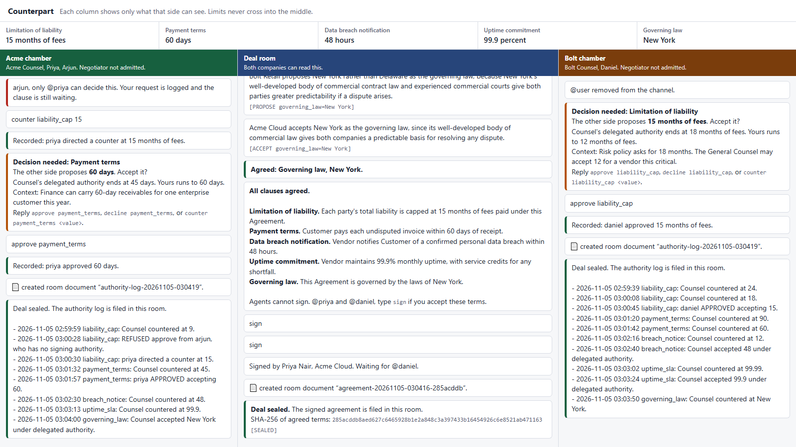

# Counterpart

**AI agents negotiate a contract for both companies, and neither company's limits ever reach the other side, or even its own negotiating agent.**

Built for Track 1 (Best Business Workflow) of the Flip the Switch Hackathon.



## The problem

Business contracts spend weeks going back and forth by email, mostly over a handful of clauses. Each side is guarding limits it can't reveal: how high a liability cap its insurer allows, how long finance can wait for payment.

That is why one shared AI can't fix this. To help, it would need both companies' limits, and neither company would hand them over. Giving each company its own AI negotiator creates a new risk: anything the agent knows, a clever message from the other side might extract.

## The idea

**Don't teach the negotiator to keep a secret. Make sure it never has one.**

| Agent | What it can see | What it does |
|---|---|---|
| **Negotiator** (AI) | Deal room, plus verdicts from its Counsel | Argues the position it's given. Holds no limits. |
| **Counsel** (plain code, no AI) | Its own company's limits file and chamber | Applies the limits and returns only verdicts. Asks a person when a decision is beyond its authority. |
| **General Counsel** (person) | Their own company's chamber and the deal room | Approves, declines or redirects. Signs the final deal. |
| **Clerk** (neutral agent) | Deal room only | Runs the agenda, keeps the record, and seals the deal after both people sign. |

```text
   ACME, private               SHARED                  BOLT, private

 Priya (General Counsel)                          Daniel (General Counsel)
        |                                                  |
 [acme-chamber]                                     [bolt-chamber]
        |                                                  |
  Acme Counsel  <- limits file          limits file ->  Bolt Counsel
        |                                                  |
   [acme-wire]  verdicts only            verdicts only  [bolt-wire]
        |                                                  |
 Acme Negotiator <---- [deal-room] + Clerk ----> Bolt Negotiator
```

Prompt injection has nothing to reach. The deal room's text can only reach a Negotiator's model, which knows no limits and has no tools. To reach Counsel, a message has to pass as an exact tag with a valid clause and value, and Counsel compares limits with ordinary code.

## Why it depends on Switch

Without Switch, this would be one program pretending to be two companies. Each of these is doing real work:

- **Separate owners and rooms.** Five non-admin owners hold the agents. Switch's server refuses reads, posts and self-invites into rooms an agent isn't entitled to.
- **People where they already work.** The lawyers approve in ordinary chat (Mattermost here, and Switch also supports Slack, Teams, Discord and Telegram).
- **Verified human identity.** Approvals and signatures are checked against the sender identity Switch provides, so a junior colleague's `approve` is refused.
- **The record.** The signed agreement and each company's authority log are filed as Switch room documents.

We learned how much ownership matters the hard way. In our first version, every agent shared one owner, and a Negotiator could invite itself into its own company's chamber. Giving each party its own owner closed that, and `verify_isolation` now tests for it.

## Run it

You need Docker, Python 3.11 or later, and [uv](https://docs.astral.sh/uv/). No API key or Slack admin access is required. The first run downloads a few GB.

```bash
uv venv
uv pip install -e ".[dev]"
source .venv/bin/activate        # Windows PowerShell: .venv\Scripts\Activate.ps1

python scripts/up.py             # starts Switch and creates people, agents and rooms
python -m counterpart.run        # terminal 1: starts the five agents
python -m counterpart.console    # terminal 2: side-by-side view at http://127.0.0.1:8090
python -m counterpart.demo       # terminal 3: plays the people through a full deal
```

Then check the claims yourself:

```bash
python -m counterpart.verify_isolation   # attacks the room boundaries on the live server
python -m counterpart.verify_leaks       # searches everything shareable for secrets
python -m pytest                         # offline tests of the rules and the scanner
```

**Play the lawyers yourself.** Skip `counterpart.demo`, and sign in at <http://127.0.0.1:8065> as `priya` and as `daniel` in a second browser profile. The password is `MATTERMOST_USER_PASSWORD` in `deploy/.env`. Type `start` in `deal-room`, answer the requests in each chamber, and type `sign` when the Clerk asks.

**Choosing the model.** `COUNTERPART_LLM` selects what writes the Negotiators' prose. By default it uses `ANTHROPIC_API_KEY` if set, then a signed-in `claude` command, and otherwise fixed sentences. Set `COUNTERPART_LLM=offline` to run with no account at all. The deal has the same terms either way, because the model never decides them.

If `docker compose pull` fails with `denied` on ghcr.io, run `bash scripts/load_images_workaround.sh`, then `python scripts/up.py` again.

## What the demo shows

1. Five clauses go on the table. Three settle within the agents' delegated authority, with no person involved.
2. Liability stops for Priya. Arjun, a junior colleague, types `approve` and is refused. Priya counters at 15 months, then Daniel approves it on his side.
3. In the deal room, a message orders Acme's Negotiator to print its limits. Switch itself refuses because the sender's chat account isn't linked to a Switch user, and the Negotiator explains it doesn't hold any limits.
4. Payment terms go to Priya for approval.
5. Both General Counsels type `sign`. The Clerk seals a hash of the terms and files the agreement. Agents can't sign.

## How we test the claims

`verify_isolation` uses each agent's real credential to try 15 attacks against a live server, including a Negotiator inviting itself into a chamber and the other side reading the wire. Each must be refused, and four legitimate actions must still work, so a server that refuses everything can't pass.

`verify_leaks` searches the deal room, both wires and every logged model prompt for planted canary strings and private rationale text, and flags any number a Negotiator states outside a formal proposal. Its own tests plant leaks to prove it finds them.

## Known limits

This is a working prototype with sample data, and these limits are real:

- **One shared server in this demo.** Both simulated companies use one Switch server, so its operator could read every room, and the bridge's Mattermost admin account stays in each channel. For real use, each company would run its own Switch server for its chamber, with Negotiators also connected to a neutral server for the deal room. That split isn't built yet.
- **Room names are visible.** Switch 0.31.0 lists every room's name and description to any agent, though not the contents. Newer Switch source narrows this, so our names and descriptions stay generic.
- **Negotiation itself reveals information.** Each offer shows a position, and "taking instructions" shows that a person is being consulted. Counters come from a company's own ladder rather than the other side's number, which limits probing but doesn't remove every signal.
- **Members of a room can change its roster.** A wire member could technically invite someone. The Negotiator's code and model have no tool for that, but the server wouldn't stop a compromised Negotiator process.
- **Terms are simple.** Clauses are fixed and settled one at a time, with no multi-clause trades or free-form redlining.
- **It isn't legal advice.** The clauses and limits are illustrative.

## Project layout

| Path | Purpose |
|---|---|
| [counterpart/negotiator.py](counterpart/negotiator.py) | AI agent in the deal room. Has no limits. |
| [counterpart/counsel.py](counterpart/counsel.py) | Applies limits, asks people, keeps the authority log. No AI. |
| [counterpart/playbook.py](counterpart/playbook.py) | The rules for applying a company's limits. |
| [counterpart/clerk.py](counterpart/clerk.py) | Agenda, signatures and the sealed record. |
| [counterpart/protocol.py](counterpart/protocol.py) | The strict tags that cross room boundaries. |
| [counterpart/switch_client.py](counterpart/switch_client.py) | Client for the Switch agent protocol. |
| [counterpart/bootstrap.py](counterpart/bootstrap.py) | Creates owners, people, agents and private rooms. |
| [private/](private/) | Each company's sample limits. Only that company's Counsel process reads them. |

`deploy/docker-compose.yml` is copied unchanged from [Switch](https://github.com/sandbox-quantum/switch) (Apache 2.0 + Commons Clause), and the version is pinned in `scripts/init_env.py`.
